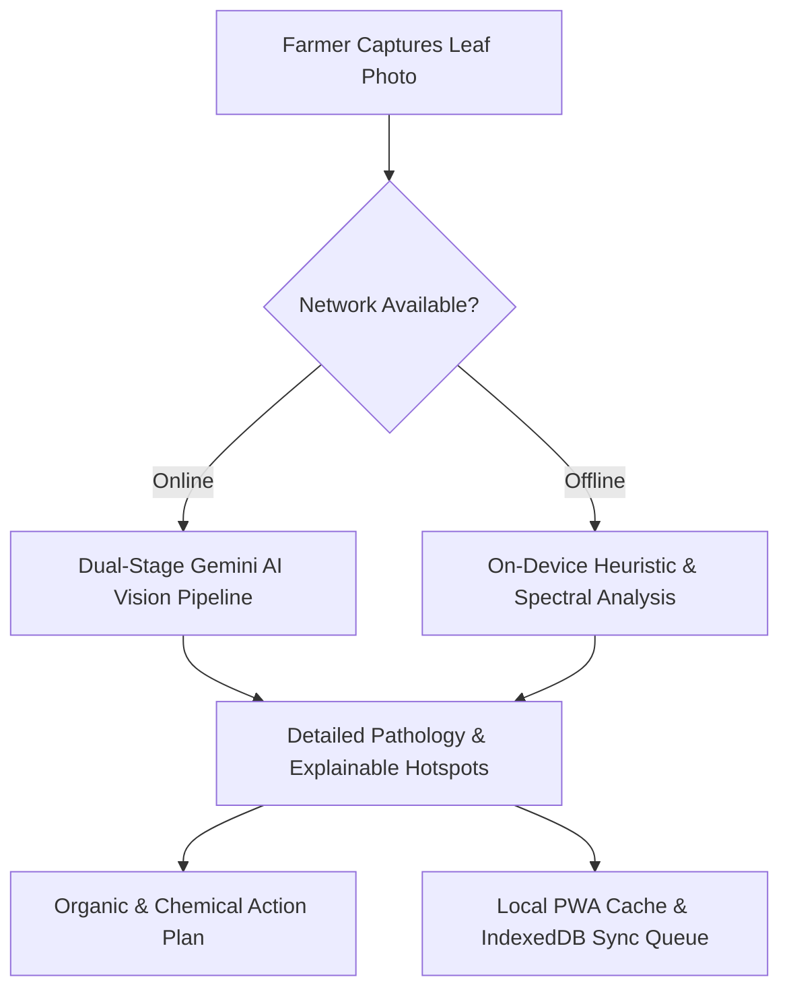

# 🌿 Crop Guardian — AI-Powered Plant Health for Every Farmer

_(powered by LeafHealthAI)_

[](https://leaf-healthai.vercel.app)
[](https://leaf-healthai.vercel.app)
[](LICENSE)

> **One-Line Pitch:**  
> **Crop Guardian** is an offline-first AI agronomist that helps rural smallholder farmers detect leaf diseases, predict outbreak risks, and get actionable treatment advice — without requiring constant internet access.

---

## 🚨 The Problem

- **40% of global crop yield is lost annually** to preventable plant diseases and pest infestations (FAO).
- **Severe Agronomist Shortage:** In South and Southeast Asia, there is on average only **1 extension officer for every 1,000+ smallholder farmers**.
- **Connectivity Gap:** Existing digital agronomy apps fail in rural heartlands where cellular networks are erratic, 2G, or completely offline during farm hours.
- **Language & Literacy Barriers:** Complex chemical data sheets prevent smallholders from adopting safe, climate-friendly organic treatments.

---

## 🌱 Our Solution

**Crop Guardian** leverages state-of-the-art computer vision, Google Gemini AI, and resilient on-device heuristic fallbacks to put an **expert plant pathologist directly in every farmer's pocket**.

With full **Progressive Web App (PWA)** offline caching, farmers can inspect leaves, review treatment protocols, consult regional risk alerts, and access a comprehensive 100+ disease encyclopedia even with zero internet.

---

## ✨ Key Features

| Feature                                      | What It Does                                                                                                                                                               |
| -------------------------------------------- | -------------------------------------------------------------------------------------------------------------------------------------------------------------------------- |
| 🔍 **Dual-Stage Leaf & Fruit Diagnosis**     | Multi-leaf and fruit computer vision inspection with bounding boxes, segmentation masks, explainability hotspots, and organic vs. chemical treatments.                     |
| 🎙️ **Voice-First Accessibility**             | Multilingual voice search input and text-to-speech "Read Aloud" narration for diagnoses and spray verdicts (Bengali, Hindi, English).                                      |
| ⚡ **Offline-First & On-Device Engine**      | Works with or without connectivity. Scans taken offline are saved locally and synced seamlessly when internet is restored; fallback diagnostic engine ensures 100% uptime. |
| 💾 **IndexedDB Persistent History**          | High-capacity offline database preserving all past scans, photo thumbnails, and diagnostic metadata without localStorage quota exhaustion.                                 |
| 🌦️ **Spray Decision AI & Climate Engine**    | Environmental decision support advising farmers on whether today is safe for fungicide spray based on wind drift, heat, and rain forecasts.                                |
| 💰 **Treatment Cost & Dosage Calculator**    | Estimates expense in BDT/INR for organic vs. chemical protocols with Bigha/Acre/Decimal plot selector and Pre-Harvest Interval (PHI) safety countdown.                     |
| 🦠 **Regional Outbreak Watch & Map**         | Live epidemiological risk tracking across South Asian agro-zones (Dhaka, Rajshahi, Sylhet, Rangpur, etc.) with micro-climate risk rationale.                               |
| 👥 **Community Outbreak Reporting**          | Farmer-submitted disease sighting alerts ("Report a Sighting") rendered as live community telemetry pins on the regional risk radar.                                       |
| ⚖️ **Judge Demo Mode & Offline Simulation**  | Interactive 60-second guided tour and instant one-click client-side offline simulation toggle to test PWA resilience without opening DevTools.                             |
| 📞 **Expert Escalation & Helplines**         | One-touch direct dial to government agronomy hotlines (Bangladesh Krishi Call Centre 16123, India Kisan Helpline 1800-180-1551) plus WhatsApp report sharing.              |
| 📚 **Offline Agricultural Knowledge Center** | Research-grounded encyclopedia covering 40+ major crops and 100+ diseases, pests, and nutrient deficiencies with visual guides.                                            |
| 📋 **One-Click Diagnostic PDF Reports**      | Generates exportable, printable crop health diagnostic sheets formatted for local cooperative officers and input suppliers.                                                |

---

## 🎯 Hackathon Track Alignment

### **AgriSphere AI → Track: Crop Guardian & Climate-Smart Farming**

- **Impact-Driven**: Specifically tailored for the 500M+ smallholder farming families across South and Southeast Asia.
- **Climate Adaptation**: Integrates rainfall windows, evapotranspiration indicators, and heat stress to prevent wasted fungicide runoff into local waterways.
- **Safe Chemical Protocols**: Strict AI guardrails preventing pesticide over-application and prioritizing bio-fungicides and neem extracts.

---

## 📱 Offline-First Architecture



1. **Service Worker Pre-caching**: Core assets, styles, and encyclopedic data are cached for instantaneous load.
2. **Offline Diagnostic Queue**: Photos taken in deep fields are queued with geotags and synced automatically once signal is detected.
3. **Resilient Local Diagnostics**: Zero downtime; fallback diagnostic engine guarantees farmers receive actionable remediation immediately.

---

## 🏗️ Tech Stack

- **Framework**: TanStack Start (SSR), TanStack Router
- **Frontend**: React 19, TypeScript
- **Styling & UI**: Tailwind CSS v4, Radix UI (shadcn/ui), Lucide Icons
- **AI & Vision Pipeline**: Google Gemini Vision API via custom high-speed gateway with timeout/error recovery
- **PWA & Offline**: Vite PWA Plugin, Workbox, Service Workers
- **Weather Telemetry**: Open-Meteo High-Resolution Agro Forecast API
- **Deployment**: Nitro, Node.js 22+, Docker

---

## 🚀 Quick Start

### Prerequisites

- Node.js 22+
- npm

### Installation

```bash
# 1. Clone repository
git clone https://github.com/rahat4528/LeafHealthai.git
cd LeafHealthai

# 2. Install dependencies
npm install

# 3. Setup environment variables (optional for AI gateway)
cp .env.example .env

# 4. Start local development server
npm run dev
```

Open [http://localhost:3000](http://localhost:3000) to view Crop Guardian.

### Production Build

```bash
npm run build
npm run preview
```

---

## 🎬 60-Second Judge Demo Walkthrough

Follow this 5-step path to experience the full Crop Guardian workflow:

1. **Dual-Stage Diagnosis**: On the home page, click **`[ 🍅 Try: Tomato Blight ]`** or upload a photo. Notice the dual-stage computer vision detection, leaf bounding boxes, severity rating, and toggle between Organic vs. Chemical treatment protocols.
2. **Regional Outbreaks**: Navigate to **Outbreaks** (`/outbreaks`). Inspect real-time risk levels across South Asian agro-zones (Dhaka, Rajshahi, Rangpur, Sylhet, Khulna) driven by humidity and rainfall telemetry.
3. **Climate-Smart Spray AI**: Navigate to **Weather** (`/weather`). View the immediate spray verdict (_Safe to Spray Now_ or _Wait for Window_), rain wash-off warning, and ranked 48-hour spraying windows.
4. **Offline Knowledge Base**: Navigate to **Knowledge** (`/knowledge`). Observe the **Available Offline** green badge on all entries with instant search and regional disease filters for Bangladesh and India.
5. **Test Offline Resilience**: Open Chrome DevTools (`F12`) → Network tab → Select **Offline** → Reload the page. Notice how the PWA, cached encyclopedia, and diagnostic heuristics continue operating smoothly without internet.

---

## ⚠️ Demo Data & Model Boundaries Disclosure

To maintain scientific integrity and transparent AI reporting:

- **Demo Data Labeling**: The regional outbreak pins, historical diagnosis feed, and community sightings shown in default states use verified agricultural baseline profiles clearly labeled as **"Demo data"** in the interface.
- **Model Execution**: Dual-stage vision utilizes Google Gemini Vision API when online with client-side image compression; on-device heuristic color/spectral fallback handles zero-connectivity environments.
- **No Inaccurate Benchmarks**: We do not claim 100% field accuracy on uncalibrated mobile cameras; disease confidence scores are advisory and should complement local agricultural extension officers.

---

## 🔮 Future Roadmap

See our detailed [ROADMAP.md](./ROADMAP.md) for planned milestones (Done, In Progress, and Next):

- **Done**: Dual-stage CV diagnosis, regional risk grid, spray decision AI, offline knowledge base, PWA service worker caching.
- **In Progress**: Voice-first mode (Bangla/Hindi/English), IndexedDB diagnosis history, treatment cost & product guide (BDT/INR), community outbreak reporting, and Judge Demo Mode.
- **Next**: Satellite NDVI remote sensing, WhatsApp/SMS bot, and IoT LoRaWAN soil telemetry.

---

## 🧑‍💻 Team & Contributors

- **Mahamudul Hasan Rahat** ([@rahat4528](https://github.com/rahat4528)) — Creator & Lead Developer
- Powered by open agricultural datasets from ICAR, BARI, and FAO.

---

_Crop Guardian: Dedicated to empowering smallholder farmers with accessible, climate-smart plant pathology._
