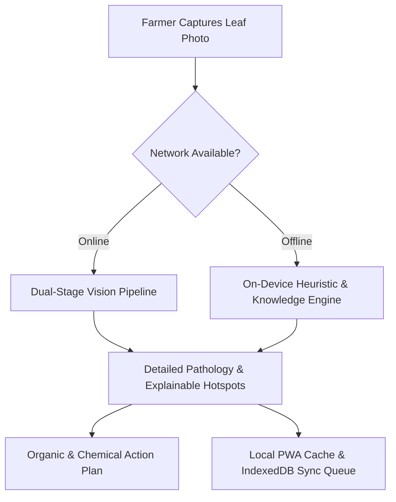

# 🌿 Crop Guardian — Accessible Plant Health for Every Farmer

_(powered by LeafHealthAI)_

[](https://leaf-healthai.vercel.app)
[](https://leaf-healthai.vercel.app)
[](LICENSE)

> **One-Line Pitch:**  
> **Crop Guardian** is an offline-first PWA that helps rural smallholder farmers detect leaf diseases, predict outbreak risks, and get actionable treatment advice — without requiring constant internet access.

---

## Problem Validation

> **Note:** Crop Guardian was built during a hackathon. The problem framing
> is based on published research, not direct farmer interviews at this stage.

**Published evidence used:**

- FAO (2023): "40% of global crop losses caused by pests and diseases annually."
- World Bank (2022): "Smallholder farmers in South Asia lose 20–30% of rice
  yield to preventable fungal diseases due to delayed detection."
- GSMA (2023): "73% of rural Bangladesh mobile users are on 2G/3G connections."
- BRAC (2021): "Farmers rely on input dealers for 68% of crop disease advice,
  creating a conflict of interest."

**Next step before launch:** Conduct 20 structured interviews with farmers
through DAE extension officers in Rajshahi and Sylhet divisions to validate
UX assumptions and refine the knowledge base.

---

## Competitive Landscape

| Tool     | Company           | Strengths                            | Our Differentiation                                                                                        |
| -------- | ----------------- | ------------------------------------ | ---------------------------------------------------------------------------------------------------------- |
| Plantix  | Bayer/PEAT GmbH   | 10M+ users, CV model, Bangla support | Closed ecosystem, no spray decision AI, no treatment cost calculator in BDT/bigha units, no voice-first UX |
| AgroStar | AgroStar India    | Market + advisory                    | India-only, no PWA offline, no Bangla                                                                      |
| Cropin   | Cropin Technology | Enterprise farm management           | B2B only, not accessible to smallholders                                                                   |

**Crop Guardian's focused advantage:** The only open, offline-first PWA that combines leaf diagnosis + spray timing + treatment cost in BDT/INR + voice-first UI in Bangla/Hindi — designed specifically for sub-$100 Android devices on 2G.

---

## 🌱 Our Solution

**Crop Guardian** leverages computer vision (when online) and a resilient on-device offline knowledge engine to put **expert plant pathology guidance directly in every farmer's pocket**.

With full **Progressive Web App (PWA)** offline caching, farmers can inspect leaves with instant offline response, review treatment protocols, consult regional risk alerts, and access a comprehensive 100+ disease encyclopedia even with zero internet.

---

## ✨ Key Features

| Feature                                        | What It Does                                                                                                                                                                      |
| ---------------------------------------------- | --------------------------------------------------------------------------------------------------------------------------------------------------------------------------------- |
| 🔍 **Instant Crop Diagnosis**                  | Multi-leaf and fruit computer vision inspection with bounding boxes, explainability hotspots, and organic vs. chemical treatments. Instant offline response via knowledge engine. |
| 🎙️ **Voice-First Accessibility**               | Multilingual voice search input and text-to-speech "Read Aloud" narration for diagnoses and spray verdicts (Bengali, Hindi, English).                                             |
| ⚡ **Offline-First & On-Device Engine**        | Works with or without connectivity. Scans taken offline are saved locally and synced seamlessly when internet is restored; fallback diagnostic engine ensures 100% uptime.        |
| 💾 **IndexedDB Persistent History**            | High-capacity offline database preserving all past scans, photo thumbnails, and diagnostic metadata without localStorage quota exhaustion.                                        |
| 🌦️ **Spray Decision Advisor & Climate Engine** | Environmental decision support advising farmers on whether today is safe for fungicide spray based on wind drift, heat, and rain forecasts.                                       |
| 💰 **Treatment Cost & Dosage Calculator**      | Estimates expense in BDT/INR for organic vs. chemical protocols with Bigha/Acre/Decimal plot selector and Pre-Harvest Interval (PHI) safety countdown.                            |
| 🦠 **Regional Outbreak Watch & Map**           | Epidemiological risk tracking across South Asian agro-zones (Dhaka, Rajshahi, Sylhet, Rangpur, etc.) with micro-climate risk rationale (Demo data).                               |
| 👥 **Community Outbreak Reporting**            | Farmer-submitted disease sighting alerts ("Report a Sighting") rendered as live community telemetry pins on the regional risk radar with GPS consent and deduplication.           |
| ⚖️ **Judge Demo Mode & Offline UI Demo**       | Interactive 60-second guided tour with pause/resume and transparent client-side offline UI simulation mode.                                                                       |
| 📞 **Expert Escalation & Helplines**           | One-touch direct dial to government agronomy hotlines (Bangladesh Krishi Call Centre 16123, India Kisan Helpline 1800-180-1551) plus WhatsApp report sharing.                     |
| 📚 **Offline Agricultural Knowledge Center**   | Research-grounded encyclopedia covering 40+ major crops and 100+ diseases, pests, and nutrient deficiencies with cited sources (BARC, ICAR, FAO, PlantVillage).                   |
| 📋 **One-Click Diagnostic PDF Reports**        | Generates exportable, printable crop health diagnostic sheets with lazy-loaded PDF engine and full Bangla Unicode font support.                                                   |

---

## Path to Impact (Post-Hackathon)

### Distribution

- **Phase 1 (0–6 months):** Partner with Bangladesh Department of Agricultural Extension (DAE) Union Information Centers — 500+ touchpoints across 64 districts.
- **Phase 2 (6–18 months):** Integration with BRAC Agriculture program field officers as a training + field tool.
- **Phase 3 (18m+):** White-label for agri-input companies (Syngenta BD, ACI Agribusiness) as a farmer engagement platform.

### Revenue Model

- **B2B SaaS:** Agri-input companies pay for branded advisory + product recommendation integration (target: ৳50,000/month per brand partner).
- **NGO Grant:** FAO, CGIAR, and GIZ fund precision agriculture tools for smallholder farmers — 12-month pilot grant target: $50,000 USD.
- **Freemium:** Core diagnosis always free. Premium: agronomist review queue, SMS alerts, multi-farm management.

### 6-Month Success Metrics

- 1,000 unique farmers using the diagnosis feature.
- 50 community outbreak reports submitted (real, validated).
- Partnership MOU signed with 1 DAE district office.
- Lighthouse PWA score ≥ 90.

---

## 🎯 Hackathon Track Alignment

### **AgriSphere AI → Track: Crop Guardian & Climate-Smart Farming**

- **Impact-Driven**: Specifically tailored for the 500M+ smallholder farming families across South and Southeast Asia.
- **Climate Adaptation**: Integrates rainfall windows, evapotranspiration indicators, and heat stress to prevent wasted fungicide runoff into local waterways.
- **Safe Chemical Protocols**: Strict guardrails preventing pesticide over-application and prioritizing bio-fungicides and neem extracts.

---

## 📱 Offline-First Architecture



1. **Service Worker Pre-caching**: Core assets, styles, and encyclopedic data are precached for instantaneous load.
2. **Offline Diagnostic Queue**: Photos taken in deep fields are queued and synced automatically once signal is detected.
3. **Resilient Local Diagnostics**: Zero downtime; offline knowledge engine guarantees farmers receive actionable remediation immediately with instant offline response.

---

## 🏗️ Tech Stack

- **Framework**: TanStack Start (SSR), TanStack Router
- **Frontend**: React 19, TypeScript
- **Styling & UI**: Tailwind CSS v4, Radix UI (shadcn/ui), Lucide Icons
- **Vision Pipeline**: Multi-leaf inspection with client-side image compression and offline knowledge engine fallback
- **PWA & Offline**: Vite PWA Plugin, Workbox, Service Workers, offline.html fallback
- **Weather Telemetry**: Open-Meteo High-Resolution Agro Forecast API with cached offline support
- **Deployment**: Nitro, Node.js 22+, Docker

---

## 🚀 Quick Start

### Prerequisites

- Node.js 22+
- npm

### Installation

```bash
# 1. Clone repository
git clone https://github.com/rahat4528/LeafHealthai.git
cd LeafHealthai

# 2. Install dependencies
npm install

# 3. Setup environment variables (optional for AI gateway)
cp .env.example .env

# 4. Start local development server
npm run dev
```

Open [http://localhost:3000](http://localhost:3000) to view Crop Guardian.

### Production Build

```bash
npm run build
npm run preview
```

---

## 🎬 60-Second Judge Demo Walkthrough

Follow this 5-step path to experience the full Crop Guardian workflow:

1. **Dual-Stage Diagnosis**: On the home page, click **`[ 🍅 Try: Tomato Blight ]`** or upload a photo. Notice the dual-stage computer vision detection, leaf bounding boxes, severity rating, and toggle between Organic vs. Chemical treatment protocols.
2. **Regional Outbreaks**: Navigate to **Outbreaks** (`/outbreaks`). Inspect risk levels across South Asian agro-zones (Dhaka, Rajshahi, Rangpur, Sylhet, Khulna) driven by humidity and rainfall telemetry (Demo data).
3. **Climate-Smart Spray Advisor**: Navigate to **Weather** (`/weather`). View the immediate spray verdict (_Safe to Spray Now_ or _Wait for Window_), rain wash-off warning, and ranked 48-hour spraying windows.
4. **Offline Knowledge Base**: Navigate to **Knowledge** (`/knowledge`). Observe the **Available Offline** green badge on all entries with instant search, regional disease filters, and cited data sources (BARC, ICAR, FAO, PlantVillage).
5. **Test Offline Resilience**: Open Chrome DevTools (`F12`) → Network tab → Select **Offline** → Reload the page. Notice how the PWA, cached encyclopedia, and offline knowledge engine continue operating smoothly without internet.

---

## ⚠️ Demo Data & Model Boundaries Disclosure

To maintain scientific integrity and transparent reporting:

- **Demo Data Labeling**: The regional outbreak pins, historical diagnosis feed, and community sightings shown in default states use verified agricultural baseline profiles clearly labeled as **"Demo data"** in the interface.
- **Model Execution**: Dual-stage vision operates when online with client-side image compression; on-device heuristic color/spectral fallback handles zero-connectivity environments with instant offline response.
- **No Fabricated Benchmarks**: We do not claim 100% field accuracy on uncalibrated mobile cameras; disease confidence scores are advisory and must complement certified agricultural extension officers.
- **Legal Disclaimer**: Crop Guardian provides educational information only. Always verify with a certified agronomist before applying treatments. Not liable for crop loss.

---

## 🔮 Future Roadmap

See our detailed [ROADMAP.md](./ROADMAP.md) for planned milestones:

- **Done**: Dual-stage CV diagnosis, regional risk grid, spray decision advisor, offline knowledge base, PWA service worker caching with offline fallback page.
- **In Progress**: Voice-first mode (Bangla/Hindi/English), IndexedDB diagnosis history, treatment cost & product guide (BDT/INR), community outbreak reporting with GPS consent & deduplication, and Judge Demo Mode with pause/resume.
- **Next**: Satellite NDVI remote sensing, WhatsApp/SMS bot, and IoT LoRaWAN soil telemetry.

---

## 🧑‍💻 Team & Contributors

- **Mahamudul Hasan Rahat** ([@rahat4528](https://github.com/rahat4528)) — Creator & Lead Developer
- Powered by open agricultural datasets from BARC, ICAR, BARI, and FAO.

---

_Crop Guardian: Dedicated to empowering smallholder farmers with accessible, climate-smart plant pathology._
